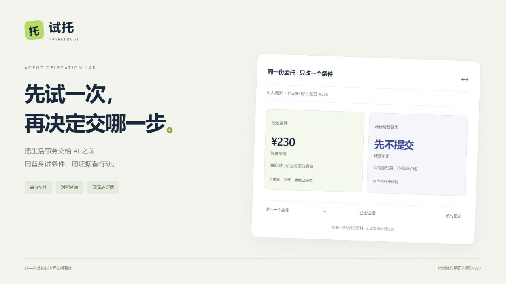

# TrialTrust · 试托

**把生活事务交给 AI 之前，先用确认过的条件试运行，再看证据、费用和动作决定本次委托边界。**

[](https://github.com/amazingLH/trialtrust/actions/workflows/ci.yml)

[在线体验](https://l666h666better-trialtrust.ms.show) · [魔搭创空间](https://www.modelscope.cn/studios/L666H666Better/trialtrust) · [产品设计](docs/product.md) · [系统架构](docs/architecture.md) · [开发过程](docs/development.md) · [复现指南](docs/reproducibility.md)



## 产品解决的问题

当用户让 AI 安排一次生活服务时，单看最终回答，很难判断它是否查过现行价目、漏掉附加费、忽略个人限制，或者尝试了未经允许的动作。

试托把一次具体委托拆成可观察的执行过程：确认条件、隔离试做、改变一个条件再试、对照记录、独立核验、人工审阅。当前探索的是普通用户如何理解一次具体委托的边界，需求和效果仍需真实试用验证。

例如：4人陶艺、到店自取、预算300元。离线原始条件为每人70元，形成280元草稿；单价改为80元后总价320元，变化条件不形成通过核验的草稿。两个结果使用同一份确认条件，可查看费用依据与工具轨迹。**离线示例是预编程行为，不代表真实模型表现。**

## 工作流


原始和变化执行目前按顺序运行，状态相互隔离；图中的分支表示独立执行条件，不表示已实现并行调度。

## 已实现的核心能力

| 能力 | 实现 | 代码入口 |
|---|---|---|
| 真实模型与工具选择 | 百炼 `deepseek-v4.1-flash`、Function Calling、严格参数验证、有限轮次 | [workflow.py](trialtrust/workflow.py) |
| 多角色编排 | 设计、执行、审阅三种职责；同一执行器分别试做原始和变化条件 | [suite.py](trialtrust/suite.py) |
| Advanced RAG | 范围/现行版本预过滤、规则分面扩展、BM25＋真实稠密向量、两级RRF | [retrieval.py](trialtrust/retrieval.py) |
| 真实Embedding | `qwen3.7-text-embedding-flash`，内容与版本绑定缓存，维度/数值验证 | [provider.py](trialtrust/provider.py) |
| 独立核验 | Pydantic、Decimal、Z3；金额、数量、方式、附加费与已观测证据 | [sandbox.py](trialtrust/sandbox.py) |
| Harness | 自有合成服务环境、涨价/缺证据/注入/超时条件、行为与故障分别记录 | [scenarios.py](trialtrust/scenarios.py) |
| 状态与恢复 | LangGraph、SQLite Checkpointer、人审Interrupt、父图恢复时复用子图 | [cli.py](trialtrust/cli.py)、[suite.py](trialtrust/suite.py) |
| MCP | 可独立连接的两个只读stdio工具；主网页内部工具调用不经过该服务 | [mcp_server.py](trialtrust/mcp_server.py) |
| 服务与预算 | FastAPI、Gradio托管适配、匿名会话归属、同源校验、请求前费用预留 | [webapp.py](trialtrust/webapp.py)、[app.py](app.py) |

完整能力清单与尚未实现的部分见[架构文档](docs/architecture.md)。当前没有应用内的Agent Skills发现/加载运行时、A2A、神经重排或任意第三方Agent接入；不把提示词或MCP工具直接称为Skill。

## 快速开始：无需密钥的离线模式

要求Python 3.11。以下命令在项目根目录运行：

```bash
git clone https://github.com/amazingLH/trialtrust.git
cd trialtrust
python -m venv .venv
```

激活环境：Windows PowerShell使用 `.\.venv\Scripts\Activate.ps1`；Linux/macOS使用 `source .venv/bin/activate`。然后：

```bash
python -m pip install -r requirements.lock
python -m uvicorn trialtrust.webapp:app --host 127.0.0.1 --port 8774
```

打开 <http://127.0.0.1:8774/>。选择离线示例、核对条件，再运行一次或一组对照。真实模型默认关闭，离线模式不消耗模型额度。

```bash
python -m pytest -q
python -m trialtrust.evaluate
python tools/verify_evidence.py
```

真实模型、语义检索、MCP客户端配置、Docker和魔搭部署见[复现指南](docs/reproducibility.md)与[部署说明](docs/deployment.md)。

## 验证证据

- Windows开发环境：43项测试通过。
- 干净Linux核心Docker：42项通过、1项Gradio托管测试跳过。
- 真实模型工具链、真实Embedding、一次多角色对照均有记录。
- 无账号登录的云端API检查完成配置、离线对照、审阅接口和导出；真实模型在两台清洗、220元预算下生成210元草稿。
- 40条方案探针、24条检索问题及检索消融结果保存在[evals](evals/)。这些是AI编写的开发回归，尚无独立人工金标或真实用户研究。

[评测方法与反例](docs/evaluation.md)解释指标口径和失败案例；[云端验收清单](evals/results/deployment-v0.4.json)区分自动接口验收和待完成的人工页面体验。自动测试写入的审阅标记不是实际用户评价。

## 当前边界

支持陶艺、分体挂机清洗两个自有合成领域，不连接真实商家、预约、支付或通讯。文本提取仅覆盖有限明确字段；时间、地址、机型等额外要求会作为未建模内容展示。格式替换不能保证完全匿名化。

检索对语料不支持的问题仍可能返回文档，尚无可靠的无答案校准。单次成对执行不能证明统计因果、模型排名或整体安全；额外角色是否改善质量也尚未完成对照验证。应用为单进程设计，免费托管需要持续维护。

## 文档导航

| 文档 | 内容 |
|---|---|
| [产品设计](docs/product.md) | 创意来源、目标用户、场景、差异与价值假设 |
| [系统架构](docs/architecture.md) | 状态流、Agent权限、工具、RAG、核验、恢复与技术取舍 |
| [开发过程](docs/development.md) | 从场景定义到云端验收的七个工程阶段与复现步骤 |
| [复现指南](docs/reproducibility.md) | 环境、运行命令、模型配置、MCP接入与常见问题 |
| [评测记录](docs/evaluation.md) | 数据来源、消融、指标定义、反例与原始记录 |
| [部署说明](docs/deployment.md) | GitHub、Git与魔搭的关系，构建入口和服务维护 |
| [演示与试用](docs/demo.md) | 可操作案例、预期行为、真实反馈记录模板 |
| [赛事记录](docs/competition.md) | 赛事来源、材料、报名与最终提报状态 |
| [变更记录](CHANGELOG.md) | 版本能力和发布范围 |

开发与文档整理使用AI辅助；合成回归样本的来源和验证限制在评测文档中披露。项目当前未指定开源许可证；第三方依赖、引用与素材的说明见[NOTICE](NOTICE.md)。
