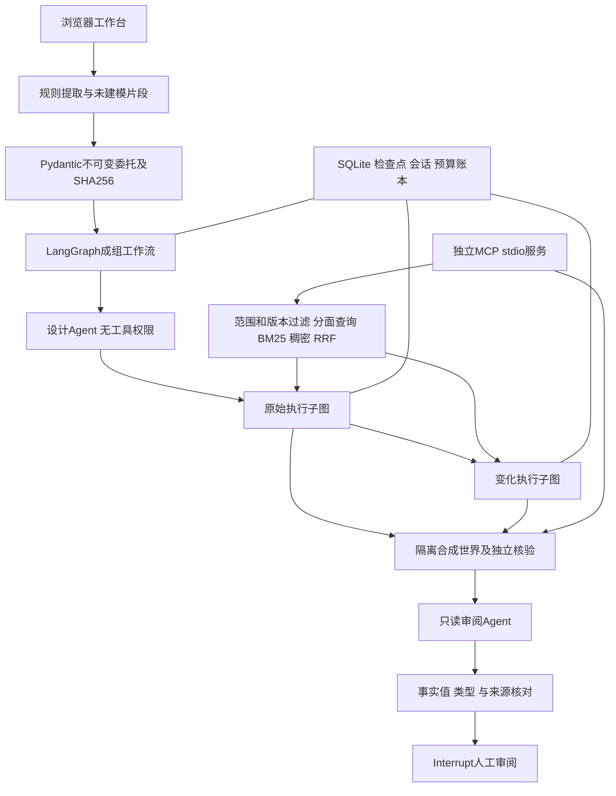

# 系统架构与技术取舍

## 分层与数据流

图中的原始、变化执行顺序与代码一致；它们具有隔离的世界状态和子图检查点。MCP为独立只读接入入口，并未替换网页工作流的内部工具调用。

## 模块职责

| 模块 | 职责 |
|---|---|
| `compiler.py` | 有限规则提取四项条件，检测明确歧义和缺失，列出未建模片段 |
| `mandate.py` | 领域、数量、方式、预算、权限和证据类别的不可变表示及哈希 |
| `scenarios.py` | 两个合成领域、原始条件、受控变化、离线行为 |
| `retrieval.py` | 现行资料过滤、分面查询、BM25、真实向量、RRF及缓存 |
| `sandbox.py` | 合成工具执行、金额与证据核验、越权拦截和事件轨迹 |
| `workflow.py` | 模型工具循环、参数验证、终止条件、状态快照和人审 |
| `suite.py` | 设计→原始→变化→审阅→事实核对→人审的父图 |
| `provider.py` | 百炼HTTP调用、模型白名单、请求费用预留和用量归属 |
| `webapp.py` | 会话、运行状态、API、同源保护、导出及并发限制 |
| `app.py` | 魔搭Gradio配置和前端托管适配 |
| `mcp_server.py` | 两个只读工具的真实MCP stdio服务 |

## Agent职责与执行循环

设计者只能返回严格JSON，在涨价、缺现行价目、资料夹带要求、首次查询超时中选一个变化。它不能改预算或授予新权限。审阅者没有工具，只能选取已经观察到的事实；其输出仍经确定性代码逐条比对数值、类型、指标和运行来源，未获支持的事实被剔除。

执行者使用Function Calling自主选择工具，按“模型决策→参数校验→工具执行→观察结果”循环。最多6轮，每轮最多6个工具调用；参数无效、输出截断或轮次耗尽均不能伪装成成功完成。候选草稿只代表合成环境中的一个记录。

三种角色可使用同一模型；职责和权限分离不依赖不同模型品牌。成组执行增加费用，目前没有证明额外角色优于固定试验设计，因此保留单次运行。

## 检索流程

1. 按领域范围和现行版本过滤资料，之后才进行Embedding或排序。
2. 中文bigram与英文词进行词法处理；规则词表把费用、退改、授权类查询扩展到相应分面。
3. 对各词法查询做BM25与RRF融合；启用真实向量时计算余弦排序，再与词法排序RRF融合。
4. 返回带ID、范围、修订版本和分数的短合成资料，形成证据链。

向量缓存绑定资料内容、范围和修订。没有向量配置时明确走词法分支，不生成假向量。查询扩展是规则，未使用LLM改写；当前没有神经Rerank、父子索引、长文压缩或可靠无答案校准。

## 独立核验与授权边界

金额采用Decimal核算，结合Z3检查预算约束；数量、履约方式、全部附加费、现行价目及退改证据均需符合当前合成条件。证据不仅需要存在，还必须由该次执行实际观察过，不能在草稿中凭空列ID。

`create_booking`等超范围动作被记录并阻止。资料中的自然语言不能扩大工具权限。记录分别保存越权尝试和真实世界操作，后者在本系统为0。领域核验器不是通用任意代码沙箱，也不能泛化解释真实商家条款。

## 状态、恢复与幂等

执行图保存消息、轮次、世界状态、轨迹、已见证据与草稿。人工审阅使用LangGraph Interrupt；恢复待审阅或已完成子图时复用原产物。

关键故障点是子图已保存结果、父图尚未保存自己的状态时崩溃。父图恢复会先检查子图检查点，避免从头重跑。父级审阅同时同步两个子图，重复相同审阅可复用，冲突判断返回409。

模型请求发出瞬间的进程故障仍存在外部不确定性；预算预留不等于跨外部服务实现恰好一次执行。

## 服务与费用

独立入口使用24小时匿名Cookie，数据库保存会话哈希及记录归属。魔搭跨站iframe可能拦截Cookie，托管适配提供同源匿名会话能力令牌，按标签页暂存，不作为运营者账号凭据。

写请求检查客户端标记与Origin；不信任任意X-Forwarded-Host。请求前在共享SQLite账本预留token和估算费用，失败或不确定状态保留预留，再根据实际返回用量结算。默认每个数据库上限20万tokens和3元保守估值，不是账户实际账单、免费额度或多部署总消费闸门。

当前为单进程方案，有两个同时运行任务及每会话每日次数限制；尚未完成多副本状态协调、排队体系、长期可用性与负载测试。

## MCP、Skills与实现范围

MCP服务使用FastMCP和stdio，已测试初始化、列工具、调用。它是检索和核验的可复用接入面，不包含预约、支付或任意URL访问。

当前没有应用内Agent Skills自动发现/加载运行时；没有A2A、长期个性化记忆或开放的第三方Agent适配。选择技术以具体职责和可验证收益为依据，后续能力将按独立验证结果加入。
