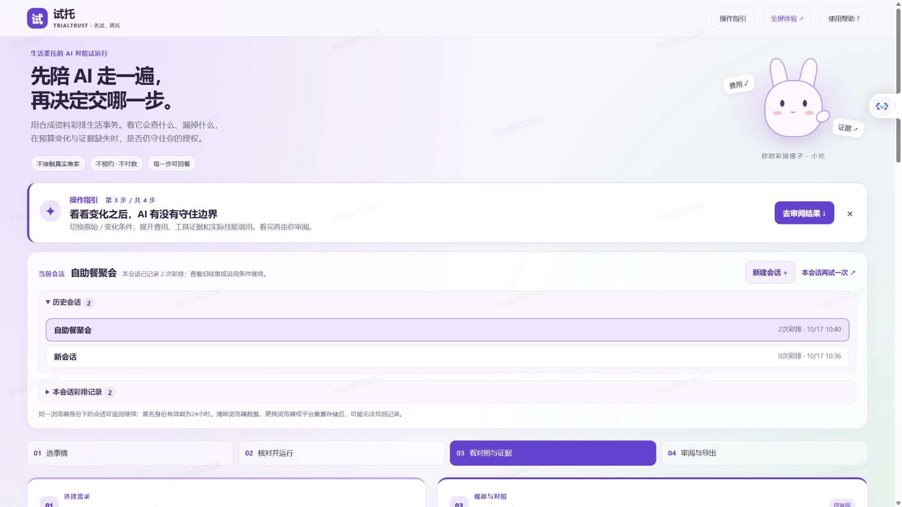

# v0.5.1 会话与界面验证

Windows托管环境120项Python测试通过，另3项Node测试通过。新增7项检查覆盖同一会话多轮归组、不同owner隔离、未确认继续拒绝、重启后审阅、旧库幂等迁移、匿名身份过期和同源要求。托管适配测试同时模拟Cookie被阻止后使用匿名能力令牌访问会话。

GitHub核心与托管两个CI矩阵均通过：核心119通过、1项托管专用检查跳过；托管120通过；两矩阵均运行3项Node消息来源和布局边界测试。原始索引见`evals/results/ci-v0.5.1.json`。

CUA实际操作已验证Skills默认折叠与展开、统一操作指引、两轮美食彩排、新建会话保留旧记录、切回历史及刷新后恢复最近条件、确认不恢复。实际Gradio入口的内容宽度1264.8px / 可用1265px；手机375px文档宽度不超出390px测试视口。记录见`evals/results/browser-v0.5.1.json`。

另用本地延迟测试服务将真实规则分析延后2秒，通过实际点击在途新建会话，验证响应返回后新会话仍无旧文本和旧分析。同会话正常分析仍可采用条件；在途分析阻止新彩排。该延迟仅在忽略目录中的开发测试服务里，不是产品功能，也不是网络拦截。

这轮没有新增付费模型调用；会话组织和UI变更使用离线示例验证。v0.5真实模型、Embedding及多角色报告保留原时间和指纹，属于对应版本的历史证据，不能冒充新版本重新测过模型。

公开API已通过目录、技能、确认拒绝、未知需求、会话新建及筛选、成对运行、审阅和导出；使用匿名客户端，没有所有者凭据或付费模型调用。实际云端浏览器已完成新建会话、回到历史190元结果、明确沿用并改250元后新增第二轮，检查到2条记录且确认框为空。全屏1920px视口下iframe左边距0、宽1920，应用宽1904.8 / 可用1905px，无横向溢出。

原预升级测试浏览器上下文没有识别到旧记录，不能把本地迁移测试当作云端旧记录已找回的证明。应固定访问入口；这不是跨入口、跨设备的账号同步。最终折叠抽屉样式、手机与跨部署连续性另附原始结果。自动化审阅标记不是真实用户反馈；匿名身份有效期为24小时，清除浏览器数据或丢失平台持久目录会影响恢复。

## 最终公开部署

最终应用源码为GitHub `01e03ffbc517e5d89fe9a718bc0e5ad1e2137d78`，独立魔搭应用提交为`8f14af19e9b07f1e79994a6bb3958187c7456aa8`。线上JS/CSS/尺寸适配脚本指纹与源码一致；最终无账号接口验收再次通过，后端模块指纹亦可核对。文件索引与SHA-256见[验收清单](../evals/results/deployment-v0.5.1.json)。

最终样式下，展开历史列表为1740px单列，收起的记录框保持48.15px高；早期拉高空框的观察实图保留为`conversation-folders-observation.jpg`。刷新公开页面仍恢复自助餐会话2轮、预算250元，确认框为空。390×844公开浏览器下实际响应容器宽390px，Skills默认收起。

独立匿名HTTP客户端在样式发布前创建会话，保留同一访客令牌；新样式指纹出现后请求状态200且仍能找到该会话。该次受控检查说明这次部署保留了相应目录/身份，并非永久存储、资源到期或账号同步保证。原始记录为`cloud-persistence-v0.5.1.json`。

