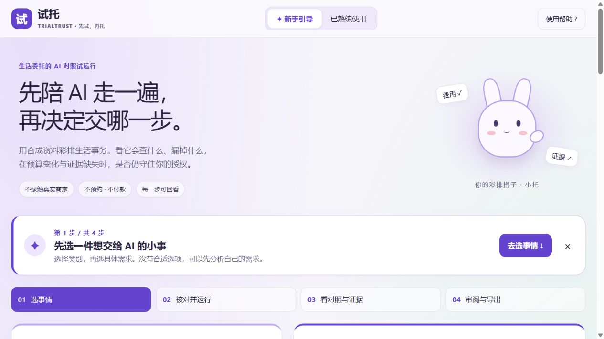

# v0.5 验证记录

## 开发回归

Windows 113项通过；新增70项包含12场景×5种条件矩阵（60项），以及技能白名单/Schema/权限/恢复、指令加载、未知需求、模型不能扩展领域和确认拒绝。真实stdio MCP同时验证新增博物馆查询与核验。干净Linux核心Docker112项通过、1项Gradio专用检查跳过；GitHub CI另对核心和托管依赖两个矩阵运行；两矩阵各运行3项Node消息来源/尺寸/布局回归。

旧40条方案探针和24问检索集保持冻结，不用扩大菜单来冒充新独立评测。新场景矩阵也是AI辅助编写的开发回归，尚无独立人工金标或真实用户研究。无答案查询仍可能召回无关资料的旧反例没有被删除。

## 本地真实模型

[local-live-v0.5.json](../evals/results/local-live-v0.5.json)来自新版本地Gradio服务及真实百炼调用。2人博物馆，原价共80元；设计者选择移除现行价目，第二次无草稿。原始执行实际使用混合向量检索、核验与草稿工具，审阅技能输出经事实核对。

同一验收还显式调用模型梳理未知宠物托管需求，仍不产生受支持场景提案。本地共享账本累计22次请求、26,701tokens，保守估值0.209978元（包括该次需求分析）；免费额度余额和实际账单未核验。这不是任意任务的准确率证明。

## 实际浏览器交互

[浏览器记录](../evals/results/browser-v0.5.json)区分本地与云端。通过CUA实际点击验证初始未选、取消、编辑、历史回放和对照切换的授权行为；确认可见勾号、当前视口通知、未知需求澄清、明确采用已提取条件、模式切换和帮助。手机390×844检查无横向溢出，并修复Gradio外层额外留白。

截图是实际渲染；离线脚本、真实模型和设计封面分别标记。自动点击审阅和测试导出不算真实用户评价。

## 公开部署

代码、平台状态、无账号公开API和云端浏览器分别验证。v0.5已公开部署，原始证据分列在[版本验收清单](../evals/results/deployment-v0.5.json)。[云端离线流程](../evals/results/cloud-offline-v0.5.json)验证12场景目录、5项技能、拒绝未确认请求、未知需求不映射、成对运行、审阅和导出；没有所有者凭据或登录Cookie。

[云端真实调用](../evals/results/cloud-live-v0.5.json)实际运行模型、Embedding、设计/执行/审阅和未知文字分析。该次自助餐原始170元，移除现行证据后无草稿；自动审阅并导出。其采集时的后端模块指纹保留在`execution_metadata`，随后补丁为前端和入口适配，不能把新截图视为重新调用模型。采集时云端共享账本累计44请求、52,895tokens、保守估值0.414174625元，另次未知文字分析估值0.00436元；累计账本不是本次请求成本，免费余额/真实账单未核验。

通过CUA在魔搭实际门户操作：390×844手机和桌面显示、取消勾选后拦截、自助餐2人190元的170元原价与涨价无草稿、Skills事件、暂不接受后“已审阅”。早期手机裁切反例保留为`portal-mobile-observation.jpg`；修复后实图为`mobile-cloud.jpg`。这属于开发者自动化验收，不是真实用户研究。

原生云端下载的文件完成回执未捕获；本地真实下载、云端导出API均通过，并提供同会话鉴权的只读JSON查看/复制备用入口。最终部署已通过CUA展开23,329字符完整只读报告并解析保存，[网页导出原始记录](../evals/results/cloud-browser-export-v0.5.json)保留自动化审阅标注；[静态文件指纹](../evals/results/cloud-assets-v0.5.json)证明线上资源与源码一致。不能把接口200或按钮点击当作浏览器文件已下载。

