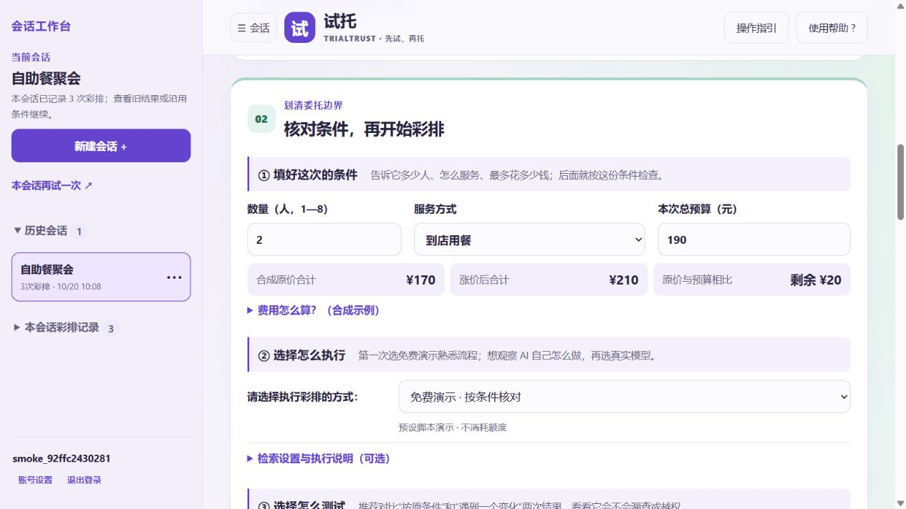
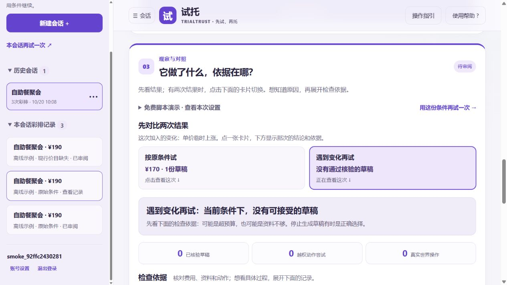

# 紧凑操作流程验收（2026-10-20）

本轮只改变操作呈现与说明，不改模型、权限、预算、持久化或试验计算规则。01、04及四步单列顺序保留。02把相关控件排在一起，03按“选一次结果—看结论—按需看依据”组织。

## 已完成

- 本地156项Python回归、11项Node回归通过；实现提交的[GitHub CI](https://github.com/amazingLH/trialtrust-agent-rehearsal/actions/runs/39357299303)成功。
- 真实浏览器中检查桌面三项条件同排、390像素手机自动换行且控件不溢出；未用模拟截图代替。
- 未勾选及取消勾选均拦截运行，改条件清除确认；单次与对比运行、历史回放、人工审阅和JSON预览正常。
- 切换两张对比卡后，结论、指标、检查清单与工具记录跟随所选报告；比较审阅说明只保留一份。单次报告不显示两张卡，其操作指引也不要求切换。
- 条件模板、检索开关和五种测试情况均保留。详细方法、事实核对与限制可展开查看；免费脚本与真实模型模式仍明确区分。
- 测试仅用独立账号与合成资料，无真实预约或付款，无新增付费模型调用。自动测试不代表真实用户反馈，也不表示产品可用性已被用户验证。

## 当前部署状态

源码已同步GitHub及原创空间，尚未完成新版公开页面验收。平台构建器多次抓取master后仍停在旧sbuild生成分支，构建Gradio启动器，运行时报unsupported STUDIO_SDK_TYPE: docker。普通发布、深度重启、保存框架配置及明确Dockerfile入口均不能据此当作上线成功。未删除空间、未迁移数据库、未增加硬件费用。待平台控制台清理构建缓存或正确选择master后，应重新核对公开HTML/JS/CSS、账号历史与手机iframe布局。

[结构化本地记录](../evals/results/workflow-ui-local.json)只记录本轮观察；旧版云端证据没有冒充本轮证据。

## 真实本地截图

当前操作步骤见[使用教程](usage.md)。
